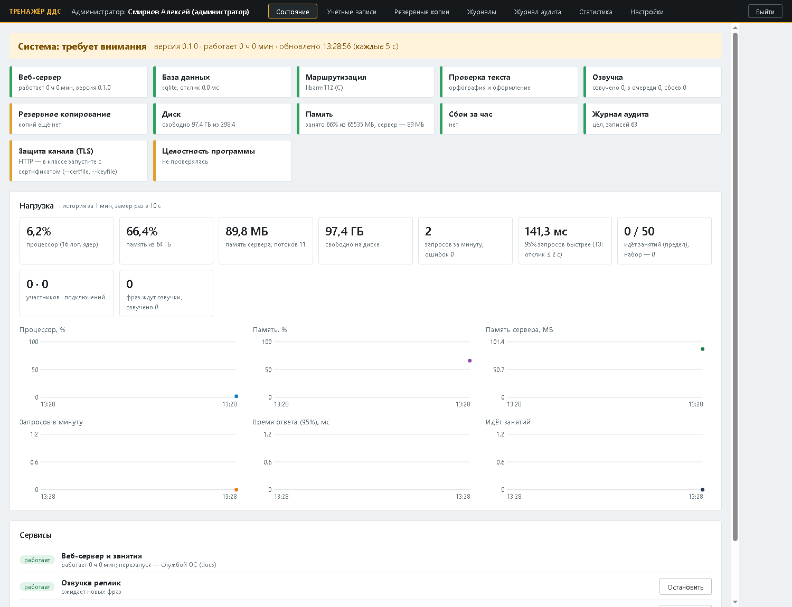
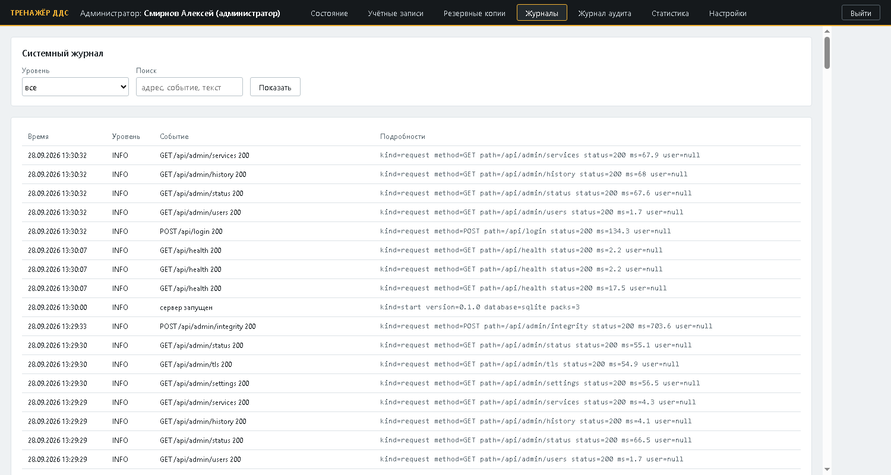
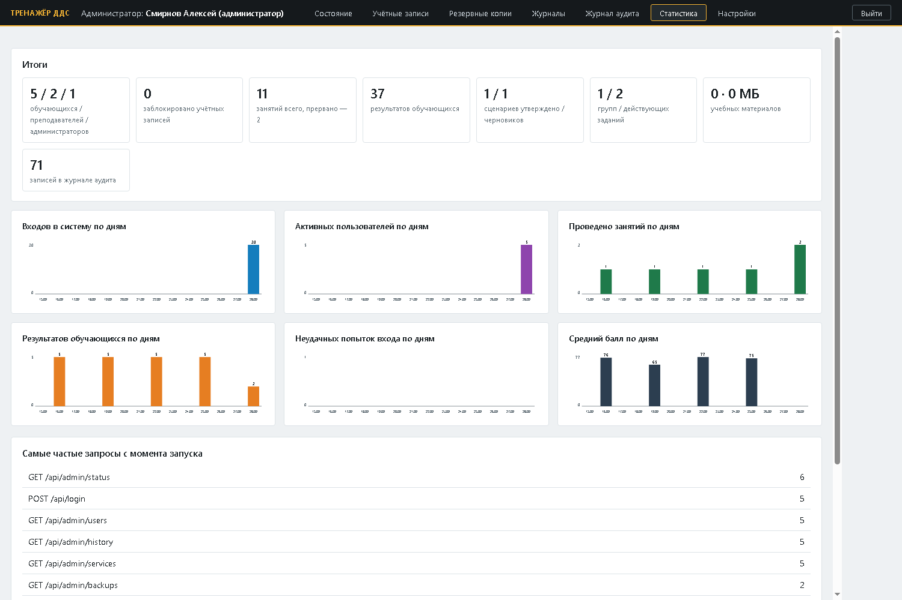

# Руководство администратора

Администратор отвечает за учётные записи, настройки, резервные копии, журналы и работоспособность сервера.
В учебный процесс он не вмешивается: не входит в занятия и не видит результатов, оценок и сценариев. Установка и
обновление программы — [deploy/README.md](../deploy/README.md), интерфейс для преподавателей и обучающихся —
[USER_GUIDE.md](USER_GUIDE.md).

## 1. Роли и права

| Действие | Обучающийся | Преподаватель | Администратор |
|---|---|---|---|
| Занятия и задания | входит в открытые для него, выполняет свои задания | создаёт и ведёт свои занятия, назначает задания своим группам | — |
| Результаты и отчёты | только свои | своих занятий и групп; экспертная оценка | — |
| Сценарии | — | генерирует, проверяет, утверждает, загружает | пакетное обновление файлов сценариев |
| Группы, материалы, аналитика | свои группы и материалы, свой прогресс | свои группы, материалы, аналитика по своим группам | — |
| Учётные записи | смена своего пароля | смена своего пароля | создание, сброс пароля, блокировка, роли |
| Настройки, сервисы, копии, журналы, аудит, статистика, целостность | — | — | да |

Права проверяются сервером на каждом запросе и при подключении к занятию; попытка превысить их записывается в
журнал аудита («отказ в доступе»).

## 2. Первый вход

1. Откройте `http://<адрес сервера>:8112` и войдите как `admin` с паролем, заданным в мастере установки. При
   установке без вопросов временный пароль — в `var\logs\install.log`; при первом входе его нужно сменить.
2. «Учётные записи» → заведите преподавателей и обучающихся (раздел 3).
3. «Настройки» — проверьте политику паролей и расписание копий; «Состояние» — что все компоненты зелёные.
4. Раздайте преподавателям и обучающимся логины и временные пароли; рабочие места класса настройте в режиме
   киоска (раздел 14).

## 3. Учётные записи

- **Новая учётная запись**: логин, имя, роль (обучающийся, преподаватель, администратор) → «Создать». Временный
  пароль показывается один раз — передайте его пользователю; при первом входе он сменит его на свой.
- **Сброс пароля** — новый временный пароль (старый перестаёт действовать, сеансы пользователя закрываются).
- **Заблокировать / Разблокировать** — закрыть или вернуть вход, не удаляя учётную запись и её результаты.
  Вход блокируется и сам — после нескольких неверных паролей подряд, на время из настроек.
- Требования к паролю: не короче минимальной длины (8 по умолчанию), обязательно буквы и цифры. Пароли хранятся
  только в виде хеша PBKDF2-SHA256 (200 000 итераций).

Каждое действие с учётными записями записывается в журнал аудита.

## 4. Подтверждение паролем

Изменение настроек, управление сервисами, создание и изменение учётных записей, сброс пароля и пакетное
обновление сценариев требуют повторного ввода пароля администратора (окно «Подтвердите действие»). Подтверждение
действует 10 минут; каждое действие — в журнале аудита.

## 5. Состояние



Вверху — общая оценка: «в порядке», «требует внимания» (есть предупреждения) или «неисправность». Страница
обновляется каждые 5 секунд.

| Компонент | Норма | Внимание / неисправность |
|---|---|---|
| Веб-сервер | работает, время работы, версия | — |
| База данных | отвечает быстрее 50 мс | медленнее — внимание; нет ответа — неисправность |
| Маршрутизация | C-ядро `libarm112` | эталон на Python (ядро не собрано) — внимание: результат тот же, медленнее |
| Проверка текста | орфография и оформление | pymorphy3 не установлен — без орфографии |
| Озвучка | озвучено, в очереди, сбоев | выключена или не установлена — реплики текстом; сбои — внимание |
| Распознавание речи | Vosk, словарь, микрофонов, фраз, нагрузка | выключено или не установлено — вопросы кнопками; модель не загрузилась — неисправность |
| Резервное копирование | последняя копия моложе 26 ч | копий нет или старше 26 ч — внимание; последняя попытка не удалась — неисправность |
| Диск | свободно 10% и больше | меньше 10% — внимание; меньше 5% или 0,5 ГБ — неисправность |
| Память | занято меньше 85% | 85% — внимание; 95% — неисправность |
| Сбои за час | нет | 1–5 — внимание; больше 5 — неисправность (подробности — «Журналы») |
| Журнал аудита | цепочка записей цела | нарушена — неисправность: запись изменена или удалена в обход программы |
| Защита канала (TLS) | HTTPS, срок сертификата | HTTP — внимание (раздел 13) |
| Целостность программы | файлы совпадают с эталоном | не проверялась — внимание; изменены — неисправность (раздел 10) |

**Нагрузка:** процессор, память машины и сервера, свободный диск, запросы в минуту и ошибки, время ответа
(95% запросов), идущие занятия и предел, участники и подключения, очередь озвучки — и графики за последний час.

**Сервисы:** веб-сервер и занятия (перезапускается службой ОС), озвучка реплик, распознавание речи оператора,
резервное копирование по расписанию, режим обслуживания — «Остановить» / «Запустить».

## 6. Настройки

Настройки хранятся в базе и применяются сразу, без перезапуска; каждое изменение — в журнале аудита
(«было → стало»). Адрес базы и сертификат TLS задаются при запуске сервера (переменная `A112_DB`, ключи
`--certfile`, `--keyfile`).

<!-- generated:settings -->
| Раздел | Настройка | Ключ | По умолчанию | Допустимо | Пояснение |
|---|---|---|---|---|---|
| Безопасность | Минимальная длина пароля | `security.password_min` | 8 | 8–64 | в пароле обязательны буквы и цифры |
| Безопасность | Неудачных попыток входа до блокировки | `security.max_failed` | 5 | 3–20 |  |
| Безопасность | Блокировка входа после неудачных попыток, мин | `security.lock_minutes` | 5 | 1–120 |  |
| Безопасность | Срок сеанса, ч | `security.session_hours` | 12 | 1–72 | после — вход заново; действует для новых сеансов |
| Резервное копирование | Копирование по расписанию | `backup.enabled` | да | да / нет | ТЗ: не реже одного раза в сутки |
| Резервное копирование | Время ежедневной копии (ЧЧ:ММ) | `backup.time` | 03:00 | ЧЧ:ММ |  |
| Резервное копирование | Хранить копий | `backup.keep` | 14 | 1–365 | старые удаляются после новой |
| Резервное копирование | Копировать учебные материалы | `backup.include_materials` | да | да / нет |  |
| Журналирование | Уровень журнала | `logging.level` | INFO | DEBUG, INFO, WARNING, ERROR |  |
| Журналирование | Записывать запросы к серверу | `logging.requests` | да | да / нет | метод, адрес, код ответа, время; без содержимого |
| Журналирование | Объём журнала на диске, МБ | `logging.max_mb` | 50 | 5–2000 | файлы журнала по кругу: при превышении удаляется самый старый |
| Производительность | Одновременных занятий, не больше | `performance.max_lessons` | 50 | 1–500 | ТЗ: не менее 20 одновременных сессий |
| Производительность | Обновление монитора преподавателя, с | `performance.monitor_s` | 1.0 | 0.5–10.0 |  |
| Телефония и голос | Озвучка реплик заявителя и бригады | `voice.enabled` | да | да / нет | выключено — реплики только текстом |
| Телефония и голос | Ресурсы озвучки | `voice.profile` | background | background, install | background — 1 ядро и низкий приоритет; install — все ядра, когда занятий нет |
| Телефония и голос | Распознавание речи оператора (микрофон) | `voice.asr` | да | да / нет | вопросы заявителю голосом; выключено — только кнопками и текстом |
| Режим работы | Режим обслуживания | `service.maintenance` | нет | да / нет | новые занятия и вход обучающихся закрыты; идущие занятия продолжаются |
<!-- /generated -->

## 7. Резервные копии и восстановление

Копия — zip-архив с базой (SQLite — файл базы, PostgreSQL — `pg_dump`), учебными материалами (настройка) и
манифестом SHA-256 каждого файла. Кэш озвучки, голоса и модель распознавания не копируются — они
восстанавливаются из дистрибутива. Копии лежат в `var\backups`; по расписанию — ежедневно в 03:00, хранятся
14 последних (настройки).

- «Резервные копии» → «Сделать копию сейчас»; «Проверить» — сверка с манифестом; «Скачать» — унести копию
  на другой носитель (рекомендуется хранить копии не только на сервере).
- **Восстановление** — только при остановленном сервере: текущая база перед заменой сохраняется рядом.

```powershell
Stop-ScheduledTask ARM112-Server
C:\ARM112\python\python.exe C:\ARM112\server\manage.py restore C:\ARM112\var\backups\<копия>.zip
Start-ScheduledTask ARM112-Server
```

При установке из zip-дистрибутива вместо `python\python.exe` — `.venv\Scripts\python.exe`; на Ubuntu —
`sudo systemctl stop arm112`, `sudo -u arm112 /opt/arm112/.venv/bin/python /opt/arm112/server/manage.py restore …`,
`sudo systemctl start arm112`. Для PostgreSQL — `pg_restore` из копии.

## 8. Журналы



- **Системный журнал** — события сервера в формате JSON: запуск и остановка, запросы (метод, адрес, код, время —
  без содержимого и персональных данных), сбои. Файлы `var\logs` по кругу (объём и уровень — настройки).
  Отбор по уровню и тексту — «Показать».
- **Сбои и ошибки** текущего запуска: сбои запросов, прерванные перезапуском занятия, сценарии, не прошедшие
  проверку, ошибка озвучки; «Отчёт об ошибках (CSV)» — для разработчиков.
- Журнал установки — `var\logs\install.log`.

## 9. Журнал аудита

Записываются входы и неудачные попытки, блокировки, смена и сброс паролей, действия с учётными записями,
создание, начало и завершение занятий, назначение ролей, экспертные оценки («было → стало»), изменения настроек,
сервисы, резервные копии, пакетное обновление, отказы в доступе. Каждая запись содержит хеш предыдущей: изменение
или удаление записи задним числом обнаруживает кнопка «Проверить целостность» (и компонент «Журнал аудита» в
«Состоянии»). Отбор — по действию, логину и времени; «Показать ещё» — более ранние записи. Журнал не очищается.

## 10. Статистика и целостность программы



**Статистика** — итоги (учётные записи, занятия, результаты, сценарии, группы, материалы, записи аудита) и
графики по дням: входы, активные пользователи, занятия, результаты, неудачные входы, средний балл; самые частые
запросы. Только количества, без персональных данных.

**Целостность программы** — файлы программы сверяются с эталоном SHA-256, снятым при установке. «Настройки» →
«Проверить целостность» показывает изменённые, пропавшие и лишние файлы. Папка `data\scenarios` в эталон не
входит: её законно меняет пакетное обновление. После обновления программы эталон снимают заново:
`manage.py integrity --write` (раздел 15).

## 11. Пакетное обновление сценариев

«Настройки» → «Пакетное обновление сценариев» → zip-архив с файлами `scenarios/*.json` (формат —
[SCENARIOS.md](SCENARIOS.md)) → «Установить». Перед установкой делается резервная копия; каждый сценарий
проверяется так же, как при запуске сервера (классификатор, службы, автомат статусов, эталон), негодные
отклоняются с причиной. Программа этим способом не обновляется — только дистрибутивом.

## 12. Режим обслуживания

Закрывает вход обучающихся и создание новых занятий; идущие занятия продолжаются, преподаватели и администраторы
входят. Включайте перед обновлением программы или восстановлением из копии («Сервисы» или «Настройки»).

## 13. Защита канала (TLS)

В классе рекомендуется HTTPS: пароли и токены не идут по сети открытым текстом, а браузеры дают микрофон только
защищённым адресам. Самоподписанный сертификат создаёт сам тренажёр; его нужно установить в доверенные корневые
сертификаты на рабочих местах (или взять сертификат ведомственного удостоверяющего центра).

Установка из Setup.exe — повторная настройка с TLS (база, учётные записи и результаты сохраняются):

```powershell
powershell -ExecutionPolicy Bypass -File C:\ARM112\deploy\windows\install.ps1 -Dir C:\ARM112 -Python C:\ARM112\python\python.exe -Tls -ServerName 10.0.0.5 -Unattended
```

Сертификат — `C:\ARM112\var\tls\arm112.crt`. При HTTPS сервер отдаёт HSTS, занятия идут по `wss://`.
Установка из zip и Ubuntu — ключ `-Tls` / `--tls` установщика ([deploy/README.md](../deploy/README.md)).

## 14. Рабочие места: режим киоска

Скрипты `deploy/kiosk` открывают тренажёр во весь экран без адресной строки и лишних окон, со звуком без клика
и с микрофоном без вопроса о разрешении; если сервер работает по `http://`, киоск объявляет его адрес защищённым
(только в своём профиле браузера). Установка на рабочем месте — `deploy/kiosk/README.md`.

## 15. Командная строка manage.py

Запуск: `C:\ARM112\python\python.exe C:\ARM112\server\manage.py <команда>` (установка из Setup.exe),
`C:\ARM112\.venv\Scripts\python.exe …` (из zip), `sudo -u arm112 /opt/arm112/.venv/bin/python /opt/arm112/server/manage.py …`
(Ubuntu), `python server/manage.py …` (разработка).

<!-- generated:manage -->
| Команда | Что делает |
|---|---|
| `init-db` | создать или обновить схему базы |
| `reset-password LOGIN` | выдать временный пароль |
| `seed-demo` | демо-учётки из data/demo/accounts.json |
| `seed-history [--teacher LOGIN]` | демо-история занятий для показа аналитики |
| `backup` | резервная копия сейчас (var/backups) |
| `restore FILE.zip` | восстановить из копии — при ОСТАНОВЛЕННОМ сервере |
| `integrity [--write]` | проверка целостности программы / снять эталон |
| `make-cert --host 10.0.0.5` | самоподписанный сертификат TLS для класса (var/tls) |
<!-- /generated -->

## 16. Мониторинг

`GET /api/health` (без входа) — JSON с состоянием: версия, C-ядро, база, проверка текста, озвучка, распознавание
речи, число идущих занятий и подключений. Подходит для внешней системы мониторинга. Подробности — «Состояние».

## 17. Неисправности

| Признак | Что проверить |
|---|---|
| Рабочие места не открывают тренажёр | сервер запущен (`Get-ScheduledTask ARM112-Server`, «Состояние»); правило брандмауэра «ARM112 trainer» и порт; адрес сервера в киоске (`kiosk.conf`) |
| Сервер не запускается | запустите `start-server.cmd` вручную и прочитайте ошибку; порт занят другой программой — переустановите с другим портом |
| «Система: требует внимания» | компоненты с жёлтой или красной полосой — таблица раздела 5 |
| Озвучки нет | «Состояние» → «Озвучка»; нет среды Visual C++ — поставьте распространяемый пакет Microsoft Visual C++ 2015–2022 (x64); тренажёр работает и без озвучки |
| Микрофон не работает | HTTPS или режим киоска; «Распознавание речи» в «Состоянии» и в «Сервисах» |
| Резервное копирование — неисправность | свободное место и права на `var\backups`; подробности — «Журналы» |
| Журнал аудита нарушен | база изменялась в обход программы: выясните, кто имел доступ к серверу; при необходимости — восстановление из копии |
| Целостность нарушена | файлы программы изменены: переустановите или, если это законное обновление, снимите эталон заново |
| Забыт пароль администратора | на сервере: `manage.py reset-password admin` — выведет временный пароль |
| Пользователь заблокирован | «Учётные записи» → «Разблокировать»; причина — в журнале аудита |
