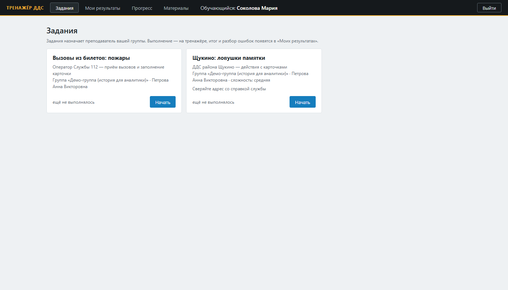
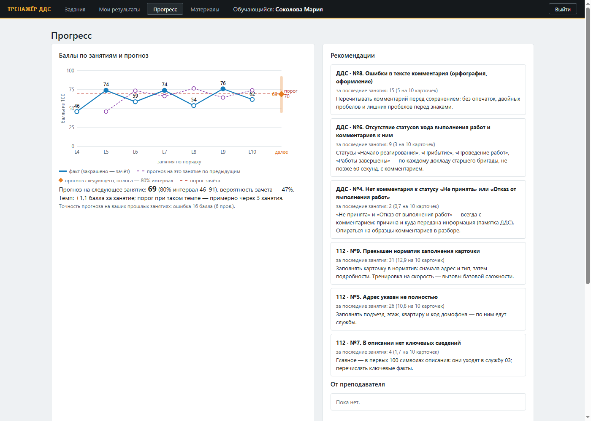
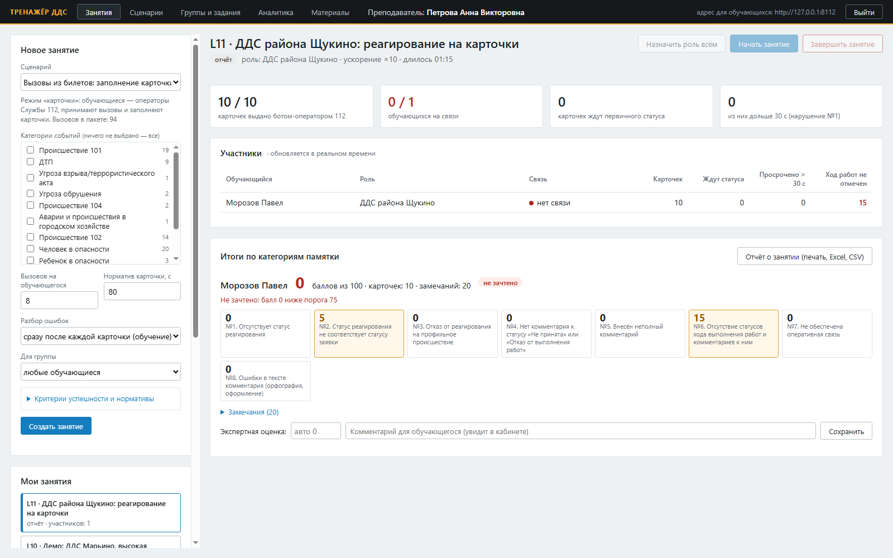
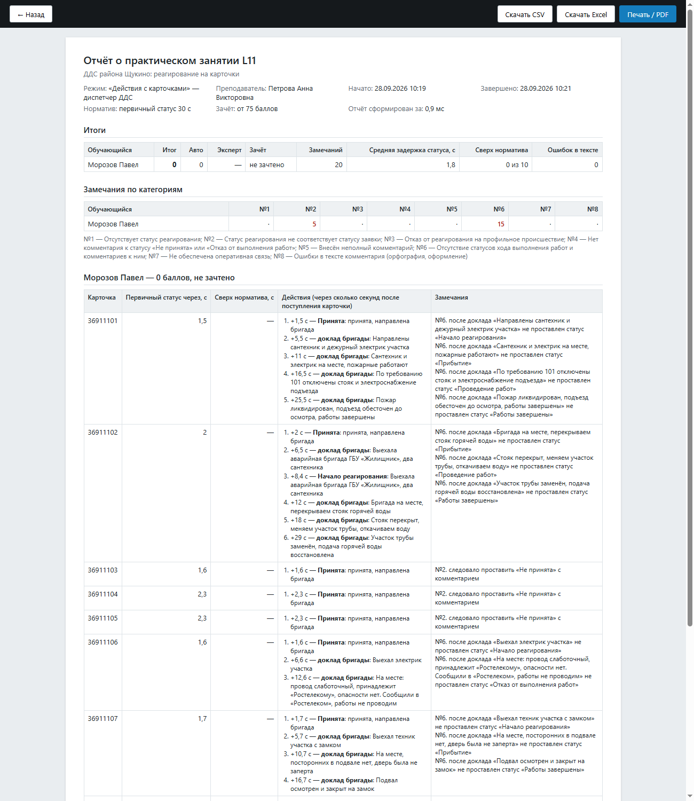
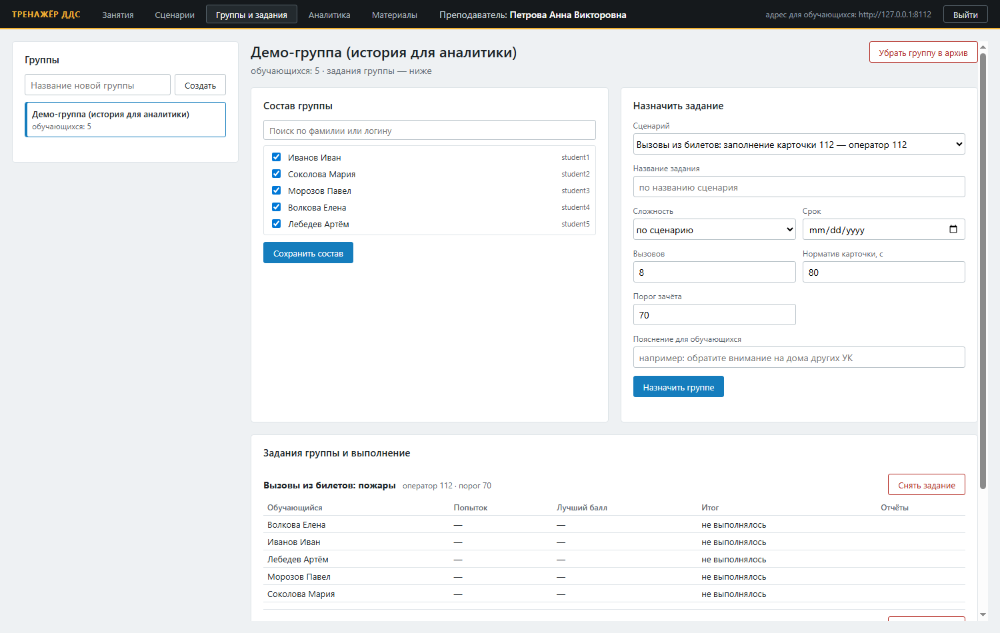
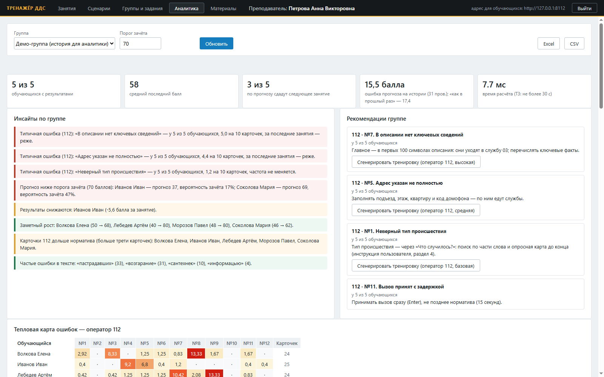

# Руководство пользователя

Руководство для обучающихся (операторы Службы 112 и диспетчеры ДДС) и преподавателей. Администратору —
[ADMIN_GUIDE.md](ADMIN_GUIDE.md), установка — [deploy/README.md](../deploy/README.md).

Тренажёр работает в браузере (Chrome, Firefox, Яндекс.Браузер) по адресу сервера учебного класса, например
`http://10.0.0.5:8112`; в классе рабочие места обычно открывают его в режиме киоска — во весь экран. Интернет не нужен.

## 1. Вход

1. Откройте адрес тренажёра, введите логин и пароль, которые выдал администратор, и нажмите «ВОЙТИ».
2. При первом входе временный пароль нужно сменить: новый пароль — не короче 8 символов, с буквами и цифрами
   (длину задаёт администратор).
3. После входа каждый попадает на свой экран: обучающийся — в кабинет, преподаватель — на «Занятия»,
   администратор — на «Состояние».

После нескольких неверных паролей подряд вход блокируется на несколько минут (по умолчанию 5 попыток и 5 минут).
Сеанс действует 12 часов. Вход хранится отдельно в каждой вкладке браузера: в соседних вкладках можно работать
под разными учётными записями. «Выйти» — в правом верхнем углу любого экрана. Забытый пароль сбрасывает
администратор — он выдаст новый временный.

## 2. Обучающийся

### 2.1 Кабинет

| Вкладка | Что там |
|---|---|
| Задания | задания преподавателя для вашей группы: сценарий, группа, сложность, срок, пояснение. «Начать» открывает тренажёр, «Продолжить» — незаконченное, «Ещё раз» — повторить |
| Мои результаты | баллы по занятиям и заданиям, «зачтено / не зачтено», оценка и комментарий преподавателя, «Разбор ошибок», «подробный отчёт» |
| Прогресс | график баллов с прогнозом следующего результата, рекомендации по вашим ошибкам, рекомендации преподавателя, ошибки по категориям |
| Материалы | учебные материалы преподавателя для всех и для вашей группы — «Открыть» |

«Перейти к занятиям» — занятия, которые открыл преподаватель. Нажмите «Войти» у своего занятия и дождитесь,
пока преподаватель назначит роль и начнёт занятие. Режим — оператор 112 или диспетчер ДДС — определяет сценарий.

**Самостоятельное задание** проходится без преподавателя: «Начать» в «Заданиях» — тренажёр открывается сразу,
вызовы или карточки начинают поступать через несколько секунд. «Завершить задание» в верхней полосе — итог сразу.

### 2.2 Рабочее место оператора Службы 112 (режим «карточки»)

Экран повторяет модуль «Приём и обработка вызовов 112»: слева — телефон, в центре — карточка 112, под ней —
разговор с заявителем, внизу — службы.

| Часть экрана | Что в ней |
|---|---|
| Полоса тренажёра (вверху) | «Звук: вкл/выкл», «Мои карточки» — сохранённые карточки, «Итог занятия», «Завершить задание» (самостоятельное задание), «Кабинет», «Выйти»; таймер заполнения карточки |
| Телефон | мигающая зелёная трубка — входящий вызов; «Принять вызов»; АОН — номер заявителя. «записи звонков», «список SMS» в тренажёре неактивны |
| Заявитель | номер «на место», фамилия и имя, статус (очевидец, пострадавший, родственник, знакомый, ребёнок, участник) |
| Адрес | страна, субъект (Москва, Московская область, другой регион), населённый пункт, улица, дом/владение, корпус, строение, квартира/офис, подъезд, этаж, код домофона, описательный адрес |
| Признаки вызова | «Пострадавшие: есть / нет», «Нет на месте / Отказ от скорой», «Нет доступа / Заблокированные», «нет контакта», «срыв звонка» |
| Тип происшествия | «Что случилось?» — поиск по части слова и частые типы кнопками; дальше опросная карта (уровни «Что и где», «Уточнение», «Подробнее» и вопросы «да / нет»); «сменить тип» — начать заново |
| Описание | «Описание со слов заявителя»: главное — в первых 100 символах, они уходят в службы |
| Разговор | реплики заявителя и ваши; «Микрофон», кнопки вопросов, «Свой вопрос заявителю…» и «Спросить» |
| Службы | подобраны по классификатору, как только определён тип и признаки; «+» — добавить службу, у службы — убрать; «сохранить» |

**Порядок работы:**

1. Звонит телефон — «Принять вызов» или Enter. Время до принятия — в нормативе (по умолчанию 15 с).
2. Выясните обстоятельства: кнопками вопросов («Что случилось?», «Адрес?», «Уточните адрес», «Как вас зовут?»,
   «Кем приходитесь?», «Есть пострадавшие?», «Угроза людям?», «Газ?», «Доступ?», «Телефон?»), голосом или своим
   вопросом текстом. Заявитель отвечает голосом, ответ дублируется текстом. Повторный вопрос об адресе даёт
   уточнённый адрес.
3. Заполните заявителя и адрес — подъезд, этаж, квартира и код важны: по ним едут службы.
4. «Что случилось?» — начните вводить часть слова («пожар», «лифт», «дтп») и выберите тип; пройдите опросную карту
   до конца: от ответов зависят код происшествия и службы.
5. Отметьте пострадавших и признаки, напишите описание.
6. Проверьте службы внизу; при необходимости добавьте или уберите.
7. «сохранить» или Alt+S. В режиме обучения сразу приходит разбор: балл, замечания по категориям и «как надо» —
   эталонная карточка. Следующий вызов поступит через несколько секунд.

**Вопросы голосом.** «Микрофон: вкл» (или Alt+M) — говорите как по телефону. Под разговором видно «слышу: …»,
а после короткой паузы (0,5 с) — итог: ««назовите адрес» → Адрес?», и заявитель отвечает. Реплика без вопроса
(«хорошо, оставайтесь на линии») попадает в разговор, заявитель её не комментирует; непонятый вопрос — подсказка
спросить иначе или кнопкой. Пока говорит заявитель, микрофон не слушает. Браузер даёт микрофон только по HTTPS или
на компьютере сервера; в классе это настраивает режим киоска. Распознаются слова разговора оператора (адрес,
пострадавшие, угроза, газ, доступ, телефон и другие) — свободная речь вне этого словаря не распознаётся.

**Как оценивается карточка 112.** Балл карточки — 100 минус штрафы за её замечания (не ниже 0), итог занятия —
среднее по карточкам; «зачтено» — итог не ниже порога преподавателя (70 по умолчанию) и замечаний не больше
допустимого. Норматив заполнения карточки — 80 с, принятия вызова — 15 с (задаёт преподаватель).

<!-- generated:rubric-112 -->
| № | Нарушение | Штраф, баллов |
|---|---|---|
| 1 | Неверный тип происшествия | 15 |
| 2 | Тип происшествия уточнён неверно | 7 |
| 3 | Неверно определены признаки происшествия | 10 |
| 4 | Ошибка в адресе | 15 |
| 5 | Адрес указан не полностью | 5 |
| 6 | Не заполнены или неверны обязательные поля | 10 |
| 7 | В описании нет ключевых сведений | 10 |
| 8 | Орфографические ошибки | 5 |
| 9 | Превышен норматив заполнения карточки | 10 |
| 10 | Список служб изменён без необходимости | 5 |
| 11 | Вызов принят с задержкой | 5 |
| 12 | Вызов не обработан | 100 |
<!-- /generated -->

### 2.3 Рабочее место диспетчера ДДС (режим «действия с карточками»)

Экран повторяет АРМ службы в Системе-112: лента «Список происшествий» и карточка происшествия. Обучающийся
видит только карточки своей службы — так их разложил классификатор.

| Часть экрана | Что в ней |
|---|---|
| Полоса тренажёра (вверху) | «Звук», «Справка службы» — какие объекты ваши, «Вызовы бригад» — все доклады старших бригад по порядку, «Итог занятия», «Завершить задание», «Кабинет», «Выйти» |
| Лента | поиск происшествий, часы, колонки: связи, ЧС, оператор, АРМ, номер, дата, время, тип происшествия, пострадавшие, адрес, статус службы; новые карточки — сверху |
| Карточка | данные происшествия, заявитель, адрес, описание оператора 112 и «Статус службы» — история статусов с временем |
| Строка статуса (внизу карточки) | список «Статус» (стрелки ↑ ↓), «Номер наряда», «Комментарий», ✓ — сохранить (Enter), ✗ — отменить (Esc) |

**Порядок работы:**

1. Новая карточка появляется в ленте. Откройте её — статус «Получена службой» проставится сам.
2. Решите, ваш ли это объект: «Справка службы» — какие дома, лифты, дворы и сети ваши, а какие обслуживают
   другие организации (управляющие компании, лифтовые организации, ГБУ «Автодороги», ОЭК).
3. Первичный статус — в пределах норматива (по умолчанию 30 секунд):
   - «Принята» — объект ваш, направляете бригаду;
   - «Не принята» — с комментарием: кто обслуживает и куда передана информация
     («Дом обслуживает УК «ПИК», информация передана в их диспетчерскую»); повтор той же ситуации —
     «Не принята» с комментарием «дубль карточки …».
4. По принятым карточкам звонит старший бригады (голосом; текст — в «Вызовы бригад»). По его докладам ставьте
   статусы хода работ с комментарием: «Начало реагирования» → «Прибытие» → «Проведение работ» → «Работы завершены».
   Если бригада сообщает, что объект не ваш, — «Отказ от выполнения работ» с комментарием, кто обслуживает.
5. «Итог занятия» — балл и замечания по категориям памятки ДДС.

<!-- generated:statuses -->
| Статус | Можно поставить следом | Комментарий |
|---|---|---|
| *(новая карточка)* | Принята, Не принята | — |
| Не принята | Принята | обязателен: причина и куда передана информация |
| Принята | Начало реагирования, Прибытие, Проведение работ, Работы завершены, Отказ от выполнения работ | — |
| Начало реагирования | Прибытие, Отказ от выполнения работ, Работы завершены | по докладу бригады |
| Прибытие | Проведение работ, Отказ от выполнения работ, Работы завершены | по докладу бригады |
| Проведение работ | Отказ от выполнения работ, Работы завершены | по докладу бригады |
| Работы завершены | — (завершающий) | по докладу бригады |
| Отказ от выполнения работ | — (завершающий) | обязателен: причина и куда передана информация |

Системные статусы — «Добавлена», «Получена службой» — проставляются сами (карточка создана, открыта службой). Норматив первичного статуса — 30 с.
<!-- /generated -->

**Как оценивается работа ДДС.** По каждой карточке проверяются первичный статус и его срок, комментарий
(обязательные сведения с учётом словоформ, орфография), статусы хода работ по докладам бригады и итоговый статус.
Правильный ответ — из памятки «Работа на АРМ-112 для ДДС»; в разборе у каждой карточки есть образец комментария.
Итог занятия — 100 минус штрафы за все замечания (не ниже 0).

<!-- generated:rubric-dds -->
| № | Нарушение | Штраф, баллов |
|---|---|---|
| 1 | Отсутствует статус реагирования | 10 |
| 2 | Статус реагирования не соответствует статусу заявки | 15 |
| 3 | Отказ от реагирования на профильное происшествие | 20 |
| 4 | Нет комментария к статусу «Не принята» или «Отказ от выполнения работ» | 10 |
| 5 | Внесён неполный комментарий | 5 |
| 6 | Отсутствие статусов хода выполнения работ и комментариев к ним | 5 |
| 7 | Не обеспечена оперативная связь | 10 |
| 8 | Ошибки в тексте комментария (орфография, оформление) | 2 |
<!-- /generated -->

### 2.4 Результаты, отчёт и прогресс

«Мои результаты» — итог каждого занятия и задания: балл, «зачтено / не зачтено», экспертная оценка преподавателя
(если он её поставил — она и есть итог), «Разбор ошибок» и «подробный отчёт» — хронология действий по каждой
карточке с секундами.

«Прогресс» — баллы по занятиям с прогнозом следующего результата: сплошная линия — факт, пунктир — прогноз на
каждое занятие по предыдущим, ромб — прогноз следующего с 80-процентным интервалом, красный пунктир — порог
зачёта. Под графиком — вероятность зачёта, темп и точность прогноза на ваших прошлых занятиях. Справа —
рекомендации по вашим частым ошибкам (с правилом из памятки или инструкции) и рекомендации преподавателя.

## 3. Преподаватель

Экран преподавателя: «Занятия», «Сценарии», «Группы и задания», «Аналитика», «Материалы». В верхней полосе —
адрес для обучающихся. Преподаватель видит только свои группы, занятия и их результаты.

### 3.1 Занятия

**Новое занятие:**

| Поле | Что задаёт |
|---|---|
| Сценарий | утверждённый сценарий ДДС или вызовов 112 |
| Категории событий | для вызовов 112 — какие группы происшествий давать (ничего не выбрано — все) |
| Темп | реальное время; ускорение ×2, ×5, ×10 — для показа; замедление ×2 и ×3 — для первого знакомства с АРМ |
| Вызовов на обучающегося, норматив карточки | для 112: сколько вызовов и сколько секунд на карточку |
| Разбор ошибок | сразу после каждой карточки (обучение) или только в итоге занятия (аттестация) |
| Источник карточек | для ДДС: карточки сценария, карточки, заполненные обучающимися в режиме «карточки», или вперемешку |
| Для группы | войти смогут только участники группы; «любые обучающиеся» — все |
| Критерии успешности и нормативы | порог зачёта (баллов), допустимо замечаний, норматив первичного статуса ДДС, норматив принятия вызова 112 |

**Проведение:** «Создать занятие» → занятие появляется в «Моих занятиях», обучающиеся входят сами →
«Назначить роль всем» (служба ДДС или оператор 112 из сценария) → «Начать занятие». Монитор обновляется в
реальном времени: сколько карточек выдано, кто на связи, сколько карточек ждёт первичного статуса и сколько из
них дольше норматива; по каждому участнику — карточки, ожидающие статуса, просрочки и неотмеченный ход работ.
Обрыв связи у обучающегося не мешает: при переподключении его действия досылаются.

**Итоги:** «Завершить занятие» — оценка по эталону сценария. По каждому обучающемуся — балл, «зачтено / не
зачтено» с причиной, замечания по категориям, список замечаний. «Экспертная оценка» с комментарием заменяет
автоматическую (обучающийся видит её в кабинете; изменение записывается в журнал аудита). «Отчёт о занятии
(печать, Excel, CSV)»:

### 3.2 Сценарии

1. «Сгенерировать сценарий»: режим (действия с карточками ДДС или карточки оператора 112), район (для ДДС —
   служба района становится ролью обучающихся), сложность, число карточек, «Справка службы» для обучающихся →
   «Сгенерировать». Получается черновик с эталоном: у каждой карточки — правильные статусы, объяснение по памятке
   и образец комментария; для 112 — эталонная карточка (код, признаки, адрес, факты описания) и ответы заявителя.
2. Проверьте черновик: предпросмотр показывает каждую карточку, куда её направит классификатор и замечания
   проверки текста. Карточку можно убрать или поправить комментарием. Правила понимают: «сложнее» или «сделай
   ловушку» (объект другой организации — «Не принята»), «проще» или «должна быть принята», «другой адрес» или
   «другой дом», «другое происшествие», «короче», «подробнее», «без пострадавших» или «с пострадавшими». Эталон
   пересчитывается вместе с карточкой. Непонятый правилам комментарий при подключённой языковой модели
   перефразирует текст карточки; эталон всегда остаётся за правилами.
3. Отметьте черновики → «Утвердить отмеченные» — сценарий доступен для занятий и заданий. «Копия в черновик» —
   доработать утверждённый (занятия идут по неизменной версии), «В архив» — убрать из выбора.
4. Сценарий можно загрузить из файла JSON — формат в [SCENARIOS.md](SCENARIOS.md).

### 3.3 Группы и задания

1. «Группы» → название → «Создать»; «Состав группы» — поиск по фамилии или логину, отметьте обучающихся →
   «Сохранить состав». «Убрать группу в архив» — когда курс закончен.
2. «Назначить задание»: сценарий, название, сложность, срок, число вызовов, норматив карточки, порог зачёта,
   норматив статуса ДДС, пояснение для обучающихся → «Назначить группе». Задание появляется в кабинете у каждого
   участника; выполняют его самостоятельно, сколько угодно раз.
3. «Задания группы и выполнение» — попыток, лучший балл и итог у каждого, отчёты; «Снять задание»; выгрузка
   «Excel» и «CSV».

### 3.4 Аналитика

Выберите группу и порог зачёта → «Обновить».

- **Показатели:** сколько обучающихся с результатами, средний последний балл, сколько по прогнозу сдадут
  следующее занятие, ошибка прогноза на истории группы в сравнении с прогнозом «как в прошлый раз», время расчёта.
- **Инсайты:** типичные ошибки группы и их динамика, кто по прогнозу ниже порога, у кого результаты снижаются
  или растут, превышение нормативов, частые ошибки в тексте. Красным — требует внимания, зелёным — хорошие новости.
- **Рекомендации группе** — по частым ошибкам, с правилом из памятки или инструкции; «Сгенерировать тренировку» —
  черновик сценария под эту ошибку.
- **Тепловая карта ошибок** — замечания каждой категории на 10 карточек у каждого обучающегося: видно, кому
  и что отрабатывать.
- **Прогноз** — сглаживание Холта с затуханием тренда по баллам занятий; его точность проверяется на истории:
  каждое прошлое занятие предсказывается по предыдущим и сравнивается с фактом.

«Excel» и «CSV» — выгрузка аналитики.

### 3.5 Материалы

«Загрузить материал»: файл до 50 МБ (PDF, DOCX, XLSX, PPTX, TXT, MD, CSV, JSON, XML, MP3, WAV, PNG, JPG, MP4),
название, описание и адресат — все обучающиеся или группа. Обучающиеся видят материал в кабинете во вкладке
«Материалы»; удалить его может только тот, кто загрузил.

## 4. Горячие клавиши

| Клавиши | Где | Действие |
|---|---|---|
| Enter | оператор 112 | принять входящий вызов |
| Alt+S | оператор 112 | сохранить карточку |
| Alt+M | оператор 112 | включить или выключить микрофон |
| ↑, ↓ | диспетчер ДДС | выбор статуса в списке |
| Enter | диспетчер ДДС | сохранить статус |
| Esc | везде | закрыть окно; отменить ввод статуса |

## 5. Частые вопросы

| Вопрос | Ответ |
|---|---|
| Нет звука | «Звук: вкл» в полосе тренажёра; в обычном браузере звук включается после первого клика по странице (кнопка подскажет), в режиме киоска — сразу. Без озвучки реплики остаются текстом |
| Кнопка «Микрофон» недоступна | микрофон браузер даёт только по HTTPS, на компьютере сервера или в режиме киоска; «распознавание не установлено» — к администратору |
| Не вижу своего занятия | преподаватель ещё не создал занятие или оно для другой группы; список обновляется сам |
| Оборвалась связь | страница переподключится сама; действия, сделанные без связи, дошлются — занятие продолжится с того же места |
| «Не принята» засчитана как ошибка | в комментарии нет обязательных сведений: кто обслуживает объект и куда передана информация; образец — в разборе карточки |
| Статус не ставится | после текущего статуса такой не допускается (таблица в разделе 2.3) |
| Забыл пароль | администратор сбросит его и выдаст временный |
